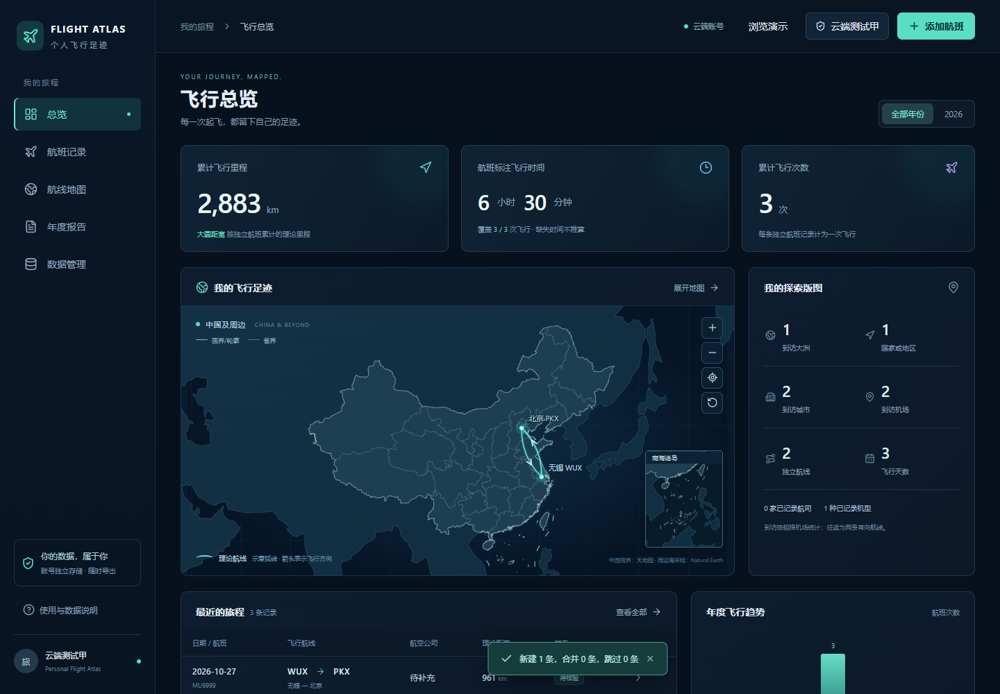
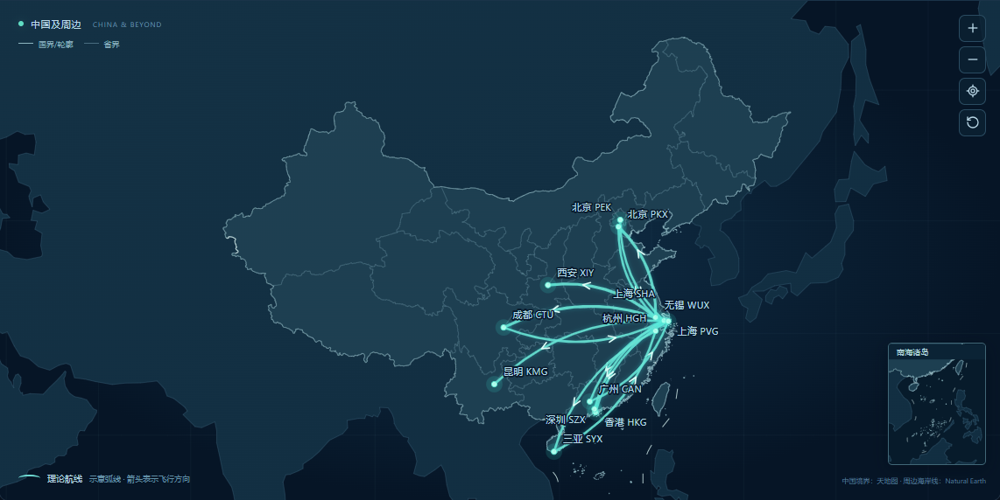
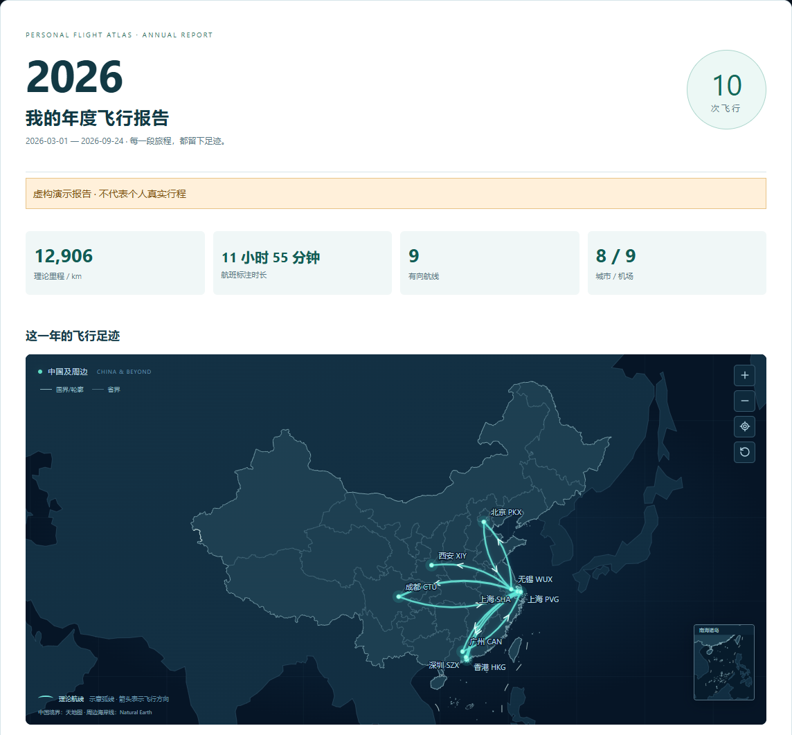
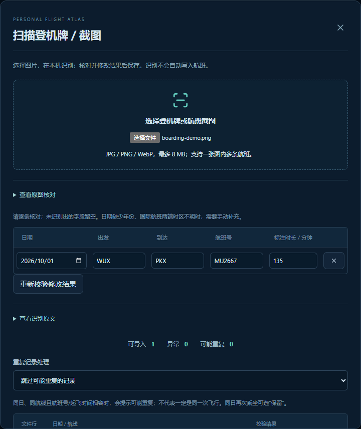
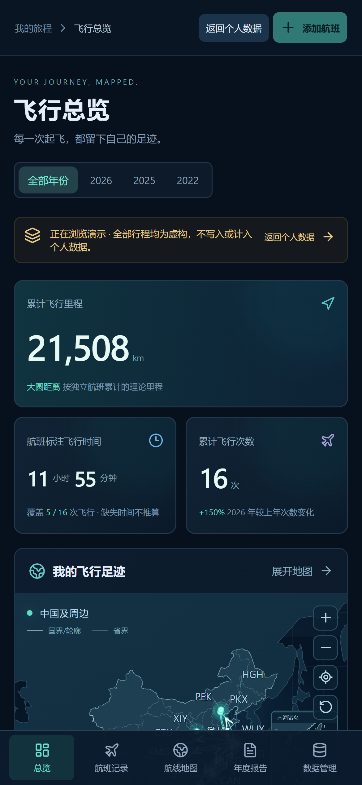
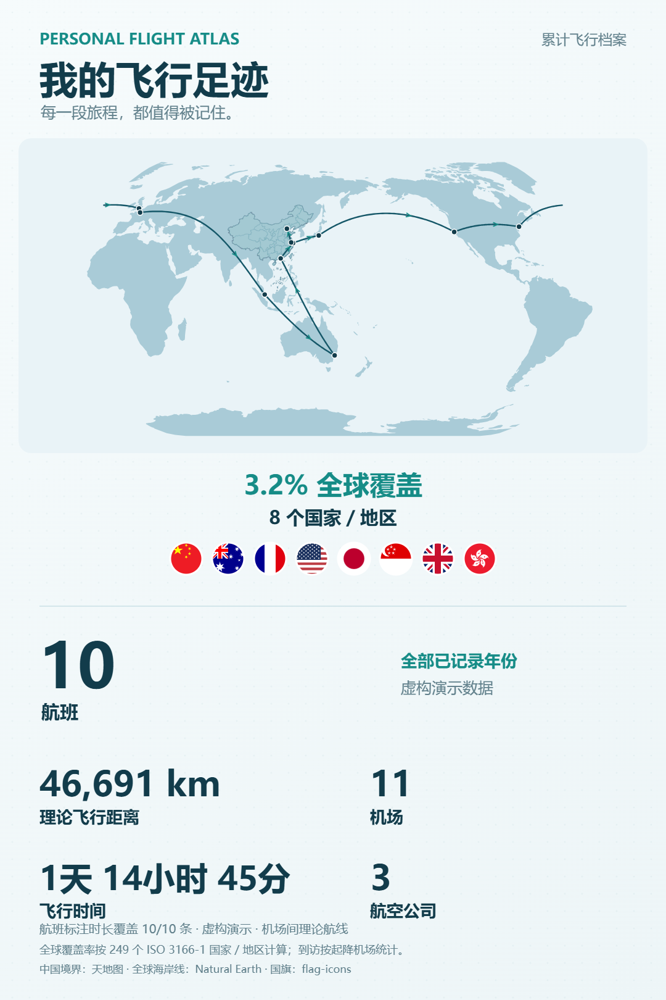
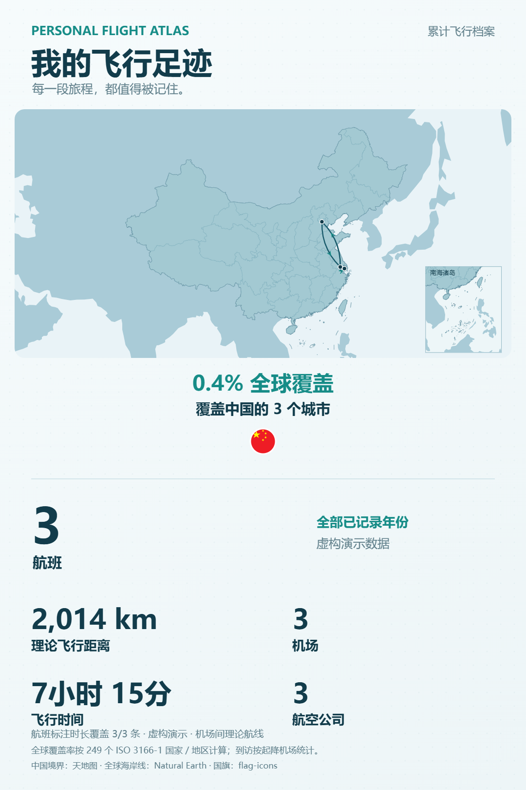

# Personal Flight Atlas · 个人飞行足迹

用 Codex 协作开发的中文飞行档案：把历史行程整理成地图、统计和年度报告。

**在线使用：[personal-flight-atlas.pages.dev](https://personal-flight-atlas.pages.dev)**

v0.3 新增世界地图、国际航线和飞行足迹分享图；航线排行显示城市，机场排行显示全称。支持注册、登录、独立账号和云端行程，电脑、手机登录同一账号即可使用。仍保留下面的 Windows 单人本地模式。

## 在线账号

- 用 3–32 位字母、数字、下划线或短横线注册用户名，密码至少 12 位；昵称可选。新账号从空白档案开始。
- 点击右上角昵称管理账号：修改密码、退出登录。修改密码会撤销所有设备的旧会话，同一浏览器的其他标签页也会更新状态。
- 每个账号独立保存航班和来源记录，详情、修改、删除、导入、导出、地图和报告都限定当前账号。匿名访客可浏览只读演示。
- 支持手机和电脑浏览器内 OCR：原图留在浏览器，核对并确认后才保存文字结果。首次识别需要下载同站点语言和识别资源。
- 密码经独立随机盐、PBKDF2 和服务端秘密处理；会话采用 HttpOnly / Secure / SameSite Cookie，服务端只保存会话摘要，并校验过期时间。
- 当前使用用户名和密码，未接入邮箱验证和忘记密码找回。请妥善保存密码，并定期导出行程。

### 把本地旧记录迁移到在线账号

在原本地应用的“数据管理”中导出 CSV 或 JSON；登录在线账号，选择“导入航班”，逐行核对后确认。真实个人数据不会因代码部署自动上传。




## 有哪些功能

- **飞行地图**：中国／世界地图切换，国际行程自动显示世界视图，跨太平洋和大西洋航线正确分段。机场节点、圆润弧线、方向箭头、频次线宽、拖动、缩放、点击航线筛选。支持从天地图官方导出导入中国国界／轮廓、省界和南海诸岛小图；全球底图采用物理海岸线。
- **足迹分享图**：点击“分享足迹”，生成包含地图、全球覆盖率、国家／地区、圆形旗帜和五项飞行统计的 PNG；支持选择年份。单一国家／地区改为显示覆盖城市数。图片在浏览器内生成，支持下载；兼容的手机浏览器可调用系统分享。
- **行程档案**：航班增删改查，最少只需日期、出发和到达机场；机场搜索、航班号、航司、机型、来源和备注。
- **统计总览**：按年份查看次数、理论里程、航班标注时长、城市、机场、常飞航线、航司和机型；年度／月度分布与排行。
- **登机牌／截图识别**：在线版使用浏览器内 OCR，本地版使用 Windows OCR；JPG / PNG / WebP，单图最多 8 MB，一张图片可识别多条航班。对照原图、修改、校验、确认导入。
- **年度报告**：年度地图、月度分布、新抵达机场、最长与最短航班、排行及完整清单；下载离线 HTML，或使用浏览器打印／保存 PDF。
- **公开机型查询入口**：按航班号打开公开历史查询，结合日期和航线核对；有注册号可查看飞机资料。结果由用户确认后填写，不自动推测机型。
- **数据管理**：CSV / JSON 导入导出、逐行校验、可能重复提示，跳过／补空合并／独立保留；SQLite 一致性备份、来源历史和软删除。
- **手机网页版**：在线版通过 HTTPS 登录访问；本地版可在同一受信任 Wi-Fi 内访问电脑服务。
- **演示模式**：内置 16 条虚构航班，只读，不写入或计入个人数据库。

应用没有设置固定的历史行程条数上限。当前按个人记录规模设计，统计在浏览器进行，没有做数万条记录的容量测试。

## 安装和电脑访问

需要 Windows、独立 Python 3.12、Node.js 24 LTS。安装依赖需要网络；本地模式的地图、机场、档案和年度报告可在安装后离线使用。公开查询入口需要联网。

```powershell
git clone https://github.com/snymb233/personal-flight-atlas.git
cd personal-flight-atlas
powershell -NoProfile -ExecutionPolicy Bypass -File .\Install.ps1
```

双击 `Start.cmd`，打开 <http://127.0.0.1:8765>。首次可以点击“浏览演示”体验；个人数据库从空白开始。

```powershell
# 后台启动；关闭网页不会关闭服务
powershell -NoProfile -ExecutionPolicy Bypass -File .\Start.ps1
# 停止本地入口，保留数据
powershell -NoProfile -ExecutionPolicy Bypass -File .\Stop.ps1
```

OCR 使用 Windows 本机识别引擎，需要系统具备中文 OCR 语言能力；清晰图片通常更易识别。缺失年份、日期或机场需补充，国际航班的未知时区不会自动推算。

## 本地模式的手机访问

1. 电脑与手机连接同一受信任 Wi-Fi，双击 `StartMobile.cmd`。
2. 保持启动窗口开启，在手机浏览器输入窗口显示的 `http://电脑IPv4:8767`。
3. 用户名 `atlas`，密码使用窗口显示的本次随机密码。每次重启会更换密码。

多网卡时可明确选择电脑连接手机所在网络的 IPv4：

```powershell
powershell -NoProfile -ExecutionPolicy Bypass -File .\StartMobile.ps1 -Address 192.168.1.10
```

这里的 IP 需要换成你电脑的实际地址。如 Windows 防火墙询问，只允许专用网络；脚本不会自动关闭防火墙或添加规则。Ctrl+C 关闭手机入口。电脑需要保持开机，数据仍在电脑上；没有手机离线同步功能。

局域网入口有密码和 Host / Origin 校验，当前使用 HTTP，适用于自己的受信任局域网。默认电脑入口仅监听 `127.0.0.1`；本地入口不提供 HTTPS 或多人账号。公网使用上面的 Cloudflare 在线版，请勿直接转发本地端口到互联网。

## 中国境界数据

中国境界原始文件和衍生 GeoJSON **不随开源仓库分发**，不属于 MIT 许可。在线站点使用此前已核验的官方来源数据进行地图可视化，原始经纬度不变。自行部署时，请从[天地图官方行政区划可视化入口](https://cloudcenter.tianditu.gov.cn/administrativeDivision)获取“中国 / 省 / GeoJSON”，遵守官方使用条件，在本地执行：

```powershell
.\.venv\Scripts\python.exe prepare_boundaries.py 'C:\Maps\中国_省.geojson'
npm.cmd run build
```

目前脚本针对 EPSG:4490 / CGCS2000、34 个省级面和 8 组境界线的官方导出，验证结构和坐标，只调整绘制所需点序，不简化或补造边界。官方后续更改导出结构时需要复核脚本。

未导入时，地图仍显示 Natural Earth 物理海岸线和航线，并提示缺少中国境界；周边物理海岸线不作为行政国界。本文演示截图是在本地导入官方数据后生成的，官方网页预览审图号不作为本应用审图号。

## 界面预览

以下均为真实应用界面，全部行程为虚构演示数据。







分享图示例（虚构行程）：

 

在总览、航线地图、航班记录或年度报告页面，选择年份后点击“分享足迹”，等待预览生成，再保存 PNG。年度报告分享采用当前报告年份。图片不包含账号名、原始登机牌或逐条来源信息。

## 统计口径

- 里程采用起降机场间的大圆距离，弧线是飞行方向示意，不是 ADS-B 实际轨迹。
- 时长优先采用航班标注的分钟数；否则使用已录入计划起降时刻计算。实际飞行时间不计入总览和报告，缺失时长不填为零。
- 每条独立航班计一次飞行，往返为两条有向航线。新增机场相对已保存的更早年份记录计算。
- 同日同路线可能是两次不同飞行，因此只提示“可能重复”，由用户选择导入策略。
- 分享图的“全球覆盖率”按已到达／起降机场的 ISO 3166-1 国家／地区数 ÷ 249 计算，包含地区，不代表领土面积覆盖率。中国香港、中国澳门、中国台湾沿用机场数据的 ISO 地区代码统计，名称明确标注为中国。只有一个代码时显示该国家／地区内的不同城市数；同城多个机场只计一个城市。

## 数据备份

数据库默认位于 `data/atlas.sqlite3`，原始 OCR 文本等录入证据保存为来源历史。原图只在识别时临时处理，不作为云端附件上传。请勿将个人数据库、原图或含私人信息的报告提交到公开仓库。

```powershell
powershell -NoProfile -ExecutionPolicy Bypass -File .\Backup.ps1
```

备份输出至 `data/backups/`。CSV / JSON 在“数据管理”中导出。当前未提供备份恢复向导。

## Cloudflare 部署

在线版采用 Cloudflare Pages + Pages Functions + D1；使用已有 Pages / D1 授权，未开通额外付费服务。源码中的 `backend.py` 继续用于本地模式；`functions/api/` 和 `worker/` 提供在线接口。

1. 修改 `cloudflare-deploy.json` 为自己的 Pages 项目、账号和 D1 ID，并在 Cloudflare 建立对应资源。
2. 设置 `CLOUDFLARE_API_TOKEN`（Pages Edit / D1 权限），运行 `node scripts/configure-cloud.mjs`。脚本逐条执行 `migrations/0001_accounts.sql` 并核验五张业务表，再绑定生产数据库和服务端秘密；不会导入个人记录。
3. 已有服务端秘密会保留，不会因重新部署重置用户密码。首次生成的本地秘密备份位于忽略的 `output/cloudflare-secrets.json`，请妥善保存。健康检查也会核对数据库表是否就绪。
4. `npm ci`，然后运行 `npm run deploy:cloud`。该脚本构建、检查后通过已固定版本的 Wrangler Pages 上传；`cf` 用于资源管理。没有创建新的 Wrangler Worker 配置文件。

生产配置只绑定本应用 D1；预览环境未绑定生产数据库。Functions 失败时不会回退成无认证接口。API 使用参数化 SQL、账号所有权校验、跨站访问校验、请求大小限制和登录限流。

识别模型和浏览器 OCR 引擎在构建阶段下载／复制到 `public/ocr/`，运行时由同一站点提供。生成资源、账号秘密、本地数据库、原图和内部测试输出均排除在 Git 之外。

## 开发与检查

React + TypeScript + Vite + D3 Geo；本地 FastAPI + SQLite，在线 Pages Functions + D1。主要依赖已锁定，未使用收费地图 API 或云端 OCR。

```powershell
npm.cmd run build
npm.cmd run check:cloud
node tests/check-domain.ts
npm.cmd run check:world
.\.venv\Scripts\python.exe tests/check_api.py
.\.venv\Scripts\python.exe tests/check_scan.py
.\.venv\Scripts\python.exe tests/check_lan.py
```

Python 检查及 `check-cloud.mjs` 使用临时数据库。`check-cloud-browser.js` 为上线验证脚本，会在配置的站点创建临时测试账号和虚构航班，仅在维护者明确进行部署验证时运行，并在完成后清理对应测试账号。未导入中国境界时，域逻辑检查会明确跳过可选境界数据验证。

`check-sharing-browser.js` 使用只读虚构国际／国内行程，验证世界地图、排名、PNG 下载及手机布局；系统分享只检查文件交接，不实际发送。在构建后运行 `node tests/prepare-sharing.mjs`，启动 `node node_modules/vite/bin/vite.js preview --host 127.0.0.1 --port 8772`，再用已打开浏览器的 Playwright CLI 执行 `run-code --filename tests/check-sharing-browser.js`。测试后重新 `npm run build`，移除构建目录内的临时案例再部署。

暂未实现自动获取历史机型、实时飞行状态、真实航迹回放、邮箱找回、PWA 离线同步或三维地球。后续按实际需求迭代。

## 许可

原创代码采用 [MIT](LICENSE)。第三方代码和数据许可见 [THIRD_PARTY_NOTICES.md](THIRD_PARTY_NOTICES.md)，原始许可文本保留在 `licenses/`。未复制航旅纵横受保护的界面素材；本项目与航旅纵横无关联。
