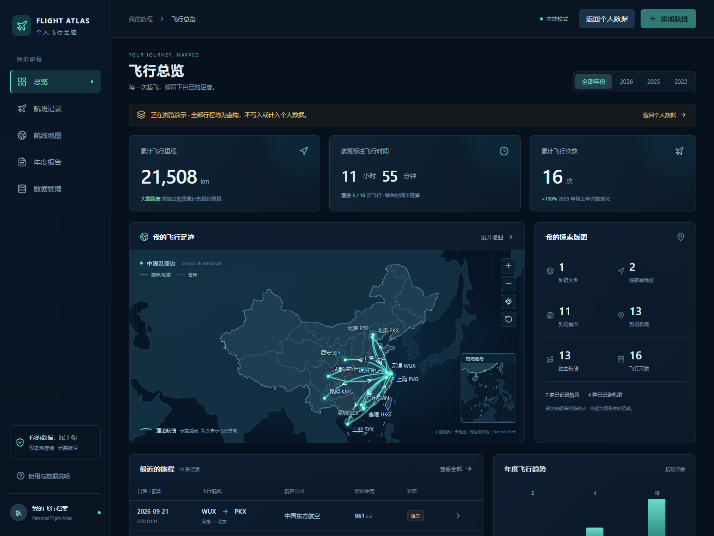

# Personal Flight Atlas · 个人飞行足迹

用 Codex 协作开发的中文飞行档案：把历史行程整理成地图、统计和年度报告。当前为 Windows 本地部署的 P0 版本，电脑和手机都通过浏览器访问，个人记录保存在自己的电脑。



## 有哪些功能

- **飞行地图**：机场节点、圆润航线弧线、方向箭头、频次线宽、拖动、缩放、点击航线筛选。支持从天地图官方导出导入中国国界／轮廓、省界和南海诸岛小图。
- **行程档案**：航班增删改查，最少只需日期、出发和到达机场；机场搜索、航班号、航司、机型、来源和备注。
- **统计总览**：按年份查看次数、理论里程、航班标注时长、城市、机场、常飞航线、航司和机型；年度／月度分布与排行。
- **登机牌／截图识别**：Windows 本机 OCR，JPG / PNG / WebP，单图最多 8 MB；一张图片可识别多条航班。对照原图、修改、校验、确认导入；不会未经确认直接保存。
- **年度报告**：年度地图、月度分布、新抵达机场、最长与最短航班、排行及完整清单；下载离线 HTML，或使用浏览器打印／保存 PDF。
- **公开机型查询入口**：按航班号打开公开历史查询，结合日期和航线核对；有注册号可查看飞机资料。结果由用户确认后填写，不自动推测机型。
- **数据管理**：CSV / JSON 导入导出、逐行校验、可能重复提示，跳过／补空合并／独立保留；SQLite 一致性备份、来源历史和软删除。
- **手机网页版**：响应式界面，同一受信任 Wi-Fi 内访问电脑服务，手机和电脑使用同一份档案。
- **演示模式**：内置 16 条虚构航班，只读，不写入或计入个人数据库。

应用没有设置固定的历史行程条数上限。当前按个人记录规模设计，统计在浏览器进行，没有做数万条记录的容量测试。

## 安装和电脑访问

需要 Windows、独立 Python 3.12、Node.js 22.13+。安装依赖需要网络；地图、机场、档案和年度报告可在安装后离线使用。公开查询入口需要联网。

```powershell
git clone https://github.com/snymb233/personal-flight-atlas.git
cd personal-flight-atlas
powershell -NoProfile -ExecutionPolicy Bypass -File .\Install.ps1
```

双击 `Start.cmd`，打开 <http://127.0.0.1:8765>。首次可以点击“浏览演示”体验；个人数据库从空白开始。

```powershell
# 后台启动；关闭网页不会关闭服务
powershell -NoProfile -ExecutionPolicy Bypass -File .\Start.ps1
# 停止本地入口，保留数据
powershell -NoProfile -ExecutionPolicy Bypass -File .\Stop.ps1
```

OCR 使用 Windows 本机识别引擎，需要系统具备中文 OCR 语言能力；清晰图片通常更易识别。缺失年份、日期或机场需补充，国际航班的未知时区不会自动推算。

## 手机如何访问

1. 电脑与手机连接同一受信任 Wi-Fi，双击 `StartMobile.cmd`。
2. 保持启动窗口开启，在手机浏览器输入窗口显示的 `http://电脑IPv4:8767`。
3. 用户名 `atlas`，密码使用窗口显示的本次随机密码。每次重启会更换密码。

多网卡时可明确选择电脑连接手机所在网络的 IPv4：

```powershell
powershell -NoProfile -ExecutionPolicy Bypass -File .\StartMobile.ps1 -Address 192.168.1.10
```

这里的 IP 需要换成你电脑的实际地址。如 Windows 防火墙询问，只允许专用网络；脚本不会自动关闭防火墙或添加规则。Ctrl+C 关闭手机入口。电脑需要保持开机，数据仍在电脑上；没有手机离线同步功能。

局域网入口有密码和 Host / Origin 校验，当前使用 HTTP，适用于自己的受信任局域网。默认电脑入口仅监听 `127.0.0.1`；尚未配置 HTTPS、公网部署或多人账号。请勿直接端口转发到互联网。

## 中国境界数据

中国境界原始文件和衍生 GeoJSON **不随仓库分发**，不属于 MIT 许可。请从[天地图官方行政区划可视化入口](https://cloudcenter.tianditu.gov.cn/administrativeDivision)获取“中国 / 省 / GeoJSON”，遵守官方使用条件，在本地执行：

```powershell
.\.venv\Scripts\python.exe prepare_boundaries.py 'C:\Maps\中国_省.geojson'
npm.cmd run build
```

目前脚本针对 EPSG:4490 / CGCS2000、34 个省级面和 8 组境界线的官方导出，验证结构和坐标，只调整绘制所需点序，不简化或补造边界。官方后续更改导出结构时需要复核脚本。

未导入时，地图仍显示 Natural Earth 物理海岸线和航线，并提示缺少中国境界；周边物理海岸线不作为行政国界。本文演示截图是在本地导入官方数据后生成的，官方网页预览审图号不作为本应用审图号。

## 界面预览

以下均为真实应用界面，全部行程为虚构演示数据。


## 统计口径

- 里程采用起降机场间的大圆距离，弧线是飞行方向示意，不是 ADS-B 实际轨迹。
- 时长优先采用航班标注的分钟数；否则使用已录入计划起降时刻计算。实际飞行时间不计入总览和报告，缺失时长不填为零。
- 每条独立航班计一次飞行，往返为两条有向航线。新增机场相对已保存的更早年份记录计算。
- 同日同路线可能是两次不同飞行，因此只提示“可能重复”，由用户选择导入策略。

## 数据备份

数据库默认位于 `data/atlas.sqlite3`，原始 OCR 文本等录入证据保存为来源历史。原图只在识别时临时处理，不作为云端附件上传。请勿将个人数据库、原图或含私人信息的报告提交到公开仓库。

```powershell
powershell -NoProfile -ExecutionPolicy Bypass -File .\Backup.ps1
```

备份输出至 `data/backups/`。CSV / JSON 在“数据管理”中导出。当前未提供备份恢复向导。

## 开发与检查

React + TypeScript + Vite + D3 Geo；FastAPI + SQLite。主要依赖版本已锁定，未使用收费地图 API 或云端 OCR。

```powershell
npm.cmd run build
node tests/check-domain.ts
.\.venv\Scripts\python.exe tests/check_api.py
.\.venv\Scripts\python.exe tests/check_scan.py
.\.venv\Scripts\python.exe tests/check_lan.py
```

测试使用临时数据库，不操作个人档案。未导入中国境界时，域逻辑检查会明确跳过可选的境界数据验证。

暂未实现自动获取历史机型、实时飞行状态、真实航迹回放、账号云同步、PWA 离线同步或三维地球。后续按实际需求迭代。

## 许可

原创代码采用 [MIT](LICENSE)。第三方代码和数据许可见 [THIRD_PARTY_NOTICES.md](THIRD_PARTY_NOTICES.md)，原始许可文本保留在 `licenses/`。未复制航旅纵横受保护的界面素材；本项目与航旅纵横无关联。
